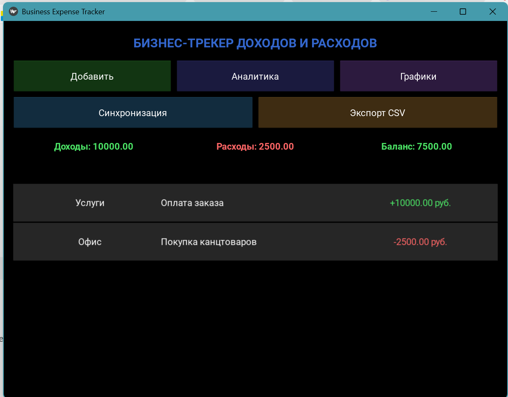
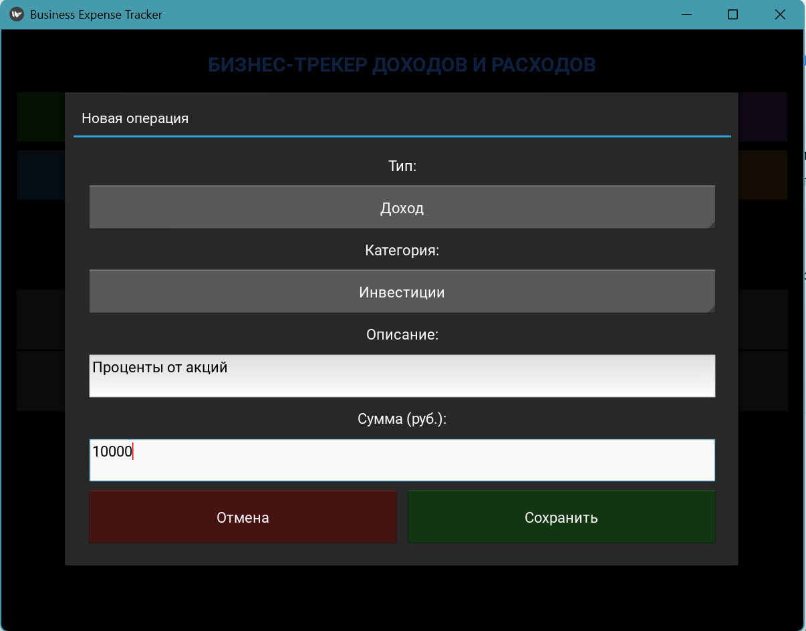
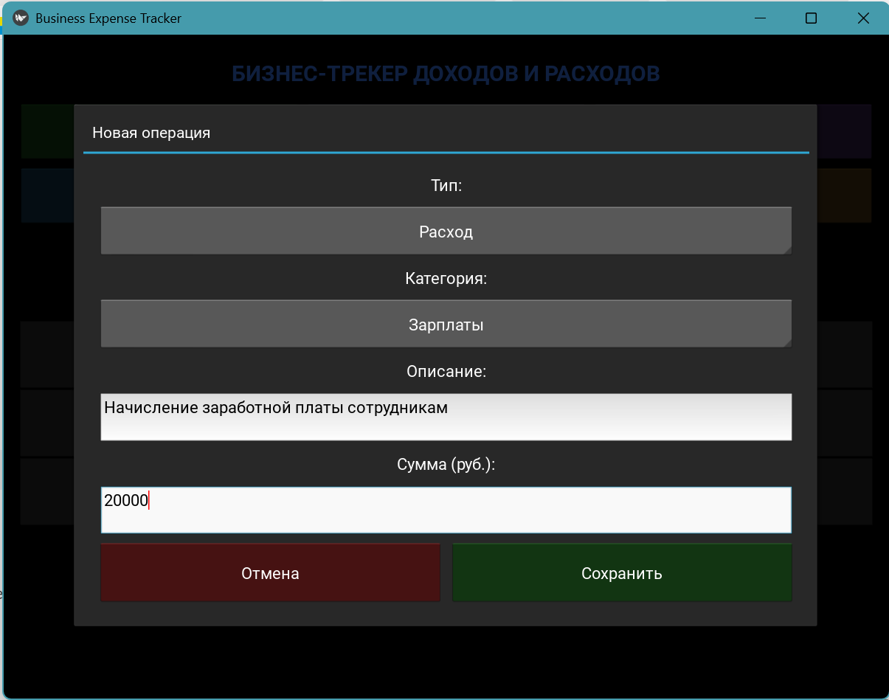
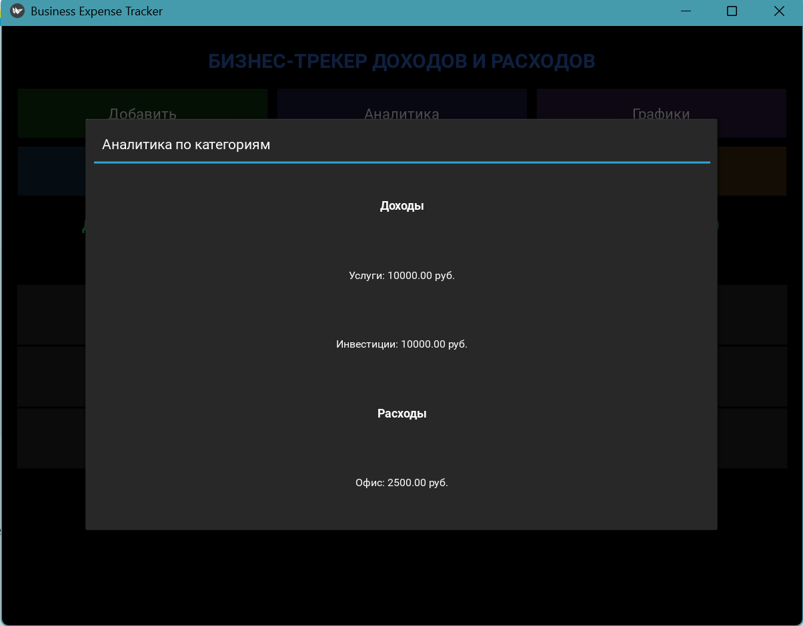
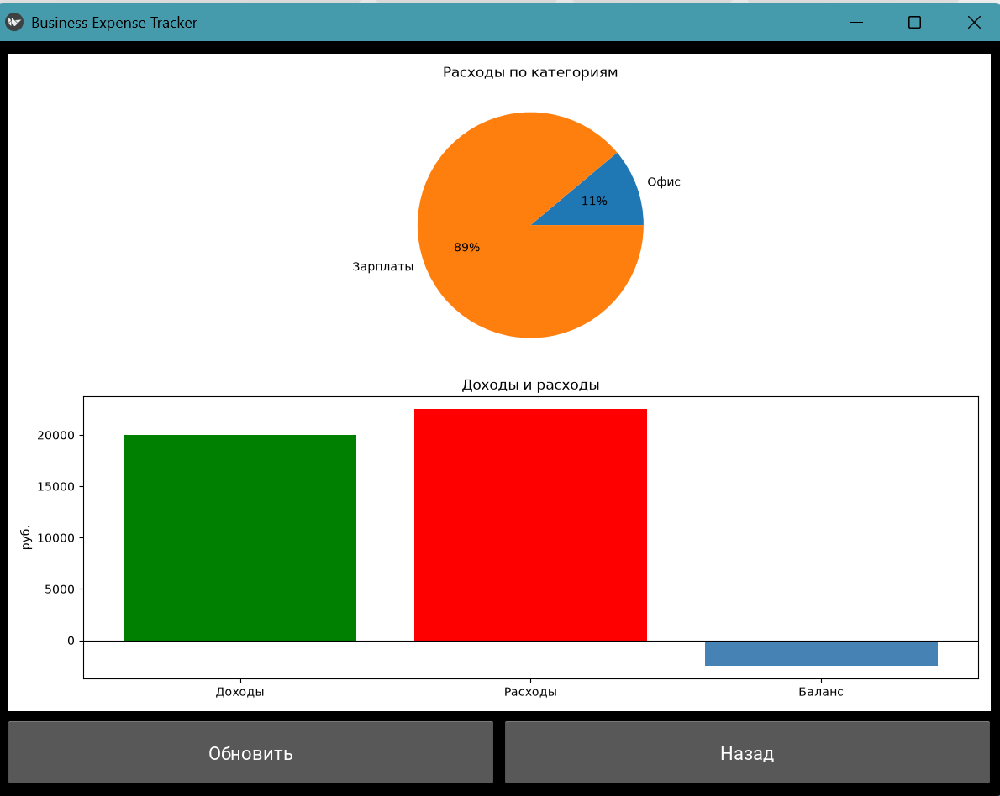
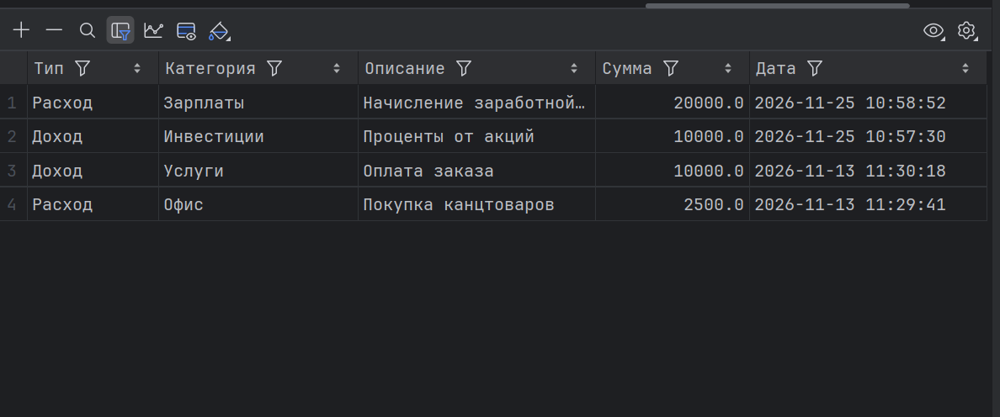
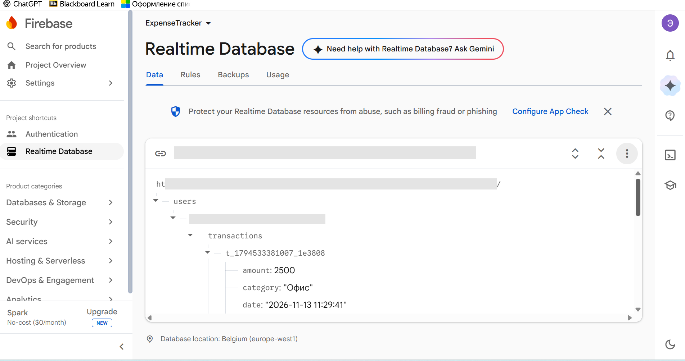
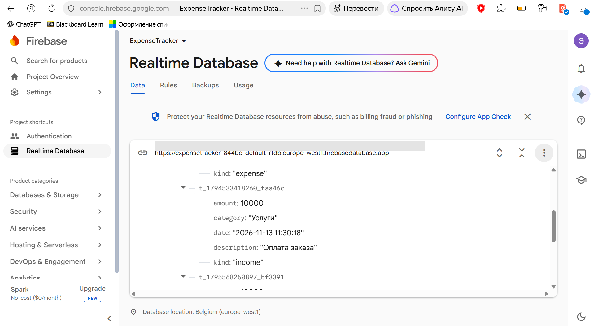
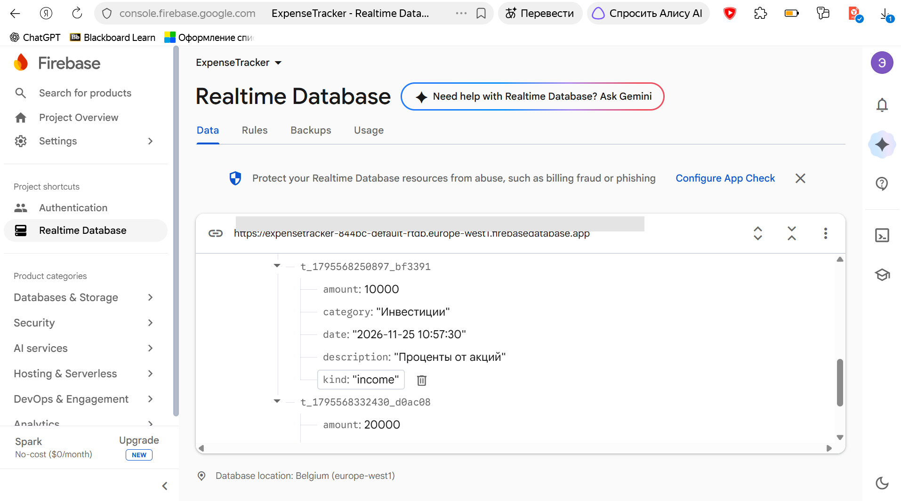

# Business Expense Tracker

**Демонстрация работы приложения** · Python / Kivy / Matplotlib / Firebase

## Введение

ExpenseTracker — настольное приложение для учёта доходов и расходов малого бизнеса. Цель демонстрации — показать добавление операций, расчёт баланса, аналитику, графики, экспорт CSV и облачную синхронизацию.

## 1. Описание работы приложения

### Запуск

```bash
pip install -r requirements.txt
python main.py
```

Для синхронизации необходимы интернет, настроенный Firebase и переменные окружения `FIREBASE_EMAIL` и `FIREBASE_PASSWORD`. Пароль не следует публиковать в репозитории.

### Результаты контрольного примера

| Доходы | Расходы | Баланс |
| ---: | ---: | ---: |
| 20 000 ₽ | 22 500 ₽ | −2 500 ₽ |

| Тип | Категория | Описание | Сумма |
| --- | --- | --- | ---: |
| Доход | Услуги | Оплата заказа | 10 000 ₽ |
| Расход | Офис | Покупка канцтоваров | 2 500 ₽ |
| Доход | Инвестиции | Проценты от акций | 10 000 ₽ |
| Расход | Зарплаты | Начисление заработной платы сотрудникам | 20 000 ₽ |

### Главный экран



*Рисунок 1 – Главное окно приложения*

На рисунке 1 представлено главное окно приложения. На начальном этапе в списке находятся доход от услуг в размере 10 000 руб. и расход на офис в размере 2 500 руб. Баланс составляет 7 500 руб. В верхней части окна расположены кнопки добавления операций, аналитики, графиков, синхронизации и экспорта CSV.

### Добавление дохода



*Рисунок 2 – Добавление доходной операции*

На рисунке 2 представлена форма добавления доходной операции. После нажатия кнопки «Сохранить» операция включается в список. Общая сумма доходов увеличивается до 20 000 руб., а баланс – до 17 500 руб. Кнопка «Отмена» позволяет закрыть форму без сохранения.

### Добавление расхода



*Рисунок 3 – Добавление расходной операции*

На рисунке 3 представлена форма добавления расходной операции. После сохранения общие расходы составляют 22 500 руб. При доходах 20 000 руб. итоговый баланс равен −2 500 руб. Отрицательное значение показывает превышение расходов над доходами.

### Аналитика по категориям



*Рисунок 4 – Аналитика по категориям*

На рисунке 4 представлено окно аналитики по категориям. Доходы распределены между услугами и инвестициями по 10 000 руб. на каждую категорию. На момент снимка, до добавления расхода на зарплаты, расходы представлены категорией «Офис» в размере 2 500 руб. Такая группировка позволяет определить основные источники поступлений и направления затрат.

### Графики



*Рисунок 5 – Диаграммы доходов, расходов и баланса*

На рисунке 5 представлено графическое представление финансовых показателей. Круговая диаграмма показывает доли расходов: заработная плата – около 89 %, офис – около 11 %. Столбчатая диаграмма сопоставляет доходы (20 000 руб.), расходы (22 500 руб.) и баланс (−2 500 руб.). Кнопка «Обновить» служит для актуализации графиков, а «Назад» – для возврата в главное окно.

### Экспорт CSV



*Рисунок 6 – Просмотр экспортированных операций*

На рисунке 6 представлен результат просмотра экспортированных операций. Файл содержит четыре записи и пять столбцов: тип, категория, описание, сумма и дата. В нём представлены обе доходные и обе расходные операции. Суммы расходов хранятся как положительные величины, а их назначение определяется полем «Тип».

### Структура облачной базы



*Рисунок 7 – Структура данных в Firebase Realtime Database*

На рисунке 7 представлена структура хранения данных в Firebase Realtime Database. В консоли Firebase записи размещены в узле users, внутри которого выделяется раздел конкретного пользователя и вложенный узел transactions. Каждая операция имеет собственный идентификатор. На рисунке 7 видна запись расхода на офис в размере 2 500 руб.

### Доход от услуг в Firebase



*Рисунок 8 – Хранение дохода от услуг в облачной базе*

На рисунке 8 представлена запись дохода от услуг в облачной базе данных. Значение kind равно income, сумма составляет 10 000 руб., категория – «Услуги», описание – «Оплата заказа». Эти значения соответствуют операции, отображённой в главном окне приложения.

### Новые записи в Firebase



*Рисунок 9 – Новые операции в облачной базе данных*

На рисунке 9 представлены новые операции, сохранённые в облачной базе данных. Для инвестиционного дохода отображаются сумма 10 000 руб., категория «Инвестиции», описание и дата операции. Ниже видна запись с суммой 20 000 руб. Наличие этих данных подтверждает сохранение новых операций в облаке. Проверка синхронизации между двумя физическими устройствами в данном отчёте не проводилась.

## Заключение

На контрольном примере продемонстрированы ввод финансовых операций, расчёт баланса, аналитика, построение диаграмм, экспорт CSV и сохранение записей в Firebase. Итоговый баланс −2 500 ₽ соответствует разнице между доходами и расходами. Проверка синхронизации между двумя физическими устройствами не проводилась.

Для просмотра исходного кода и дополнительных инструкций см. [README.md](README.md).
